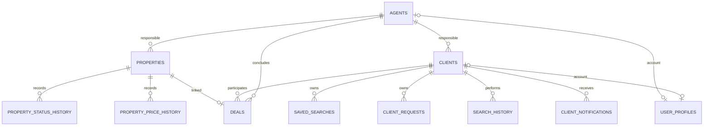

# Сопоставление с заданием

Источник: «Завдання Проект 25.pdf», проект «Система управління рієлторським агентством», страницы 6–8. На странице 8 продолжается этап 5 и описан этап 6. Слова о чеках, меню и официантах в пункте БД относятся к другому предметному примеру; здесь используются сущности агентства.

| Этап | Реализация |
| --- | --- |
| 1 | Property, Client, Agent, Deal; операции создания/чтения/редактирования/удаления недвижимости и клиентов; сделки и комиссионные. |
| 2 | Статусы и история, комбинированные фильтры, загрузка данных и запрет удаления связанных записей. |
| 3 | Финансовая аналитика, цена м², эффективность агентов, активность клиентов; до десяти сохранённых поисков и уведомления. |
| 4 | Запросы клиентов, подбор по запросам и сохранённым фильтрам, покупатели/арендаторы/владельцы, доход агентства. |
| 5 | Удалённый сервис аккаунтов: адаптер Security преподавателя либо Supabase Auth; EF Core DbContext и настоящая SQLite-миграция в .NET; нормализованные PostgreSQL-таблицы для Netlify; транзакционный импорт исходного JSON. |
| 6 | Проверяемые сервером роли manager/agent/client, отдельные кабинеты, связи владения записями, управление ролями и отчёты менеджера. |

## Этап 5: сохранение

`AgencyService` C# зависит от `IAgencyDataManager`; по умолчанию внедряется `EfAgencyDataManager`, а не JSON-сериализатор. `AgencyDbContext` определяет таблицы, ключи, связи и преобразование структур фильтра. Миграция находится в `PersistenceLayer/Migrations`; импорт и экспорт — отдельные режимы программы.

В Netlify используется тот же предметный набор в PostgreSQL, доступный серверным Functions через REST/RPC. Это самостоятельная реализация хранилища, не запуск EF Core внутри Netlify. `agency_read_snapshot` собирает данные из строк, `agency_save_snapshot` сохраняет изменения атомарно при совпадении версии. Старый JSON-документ хранится только как резервная копия.

Гибкие параметры фильтра хранятся в JSONB внутри отдельной строки поиска/запроса. Основные сущности и их связи не сериализуются в один JSON-документ. Исходный файл не удаляется, ID не заменяются; повторный импорт не затирает облачные изменения.

## Этап 6: учётные записи и доступ

Провайдер аккаунтов выбирается серверной настройкой `AUTH_PROVIDER`. Для Supabase Auth проверяется пользователь и подтверждение email; для Security преподавателя — подпись HS256, issuer, audience и срок JWT. Затем Netlify API читает роль из закрытой таблицы `user_profiles`. Форма входа/регистрации не назначает привилегированную роль. Первый менеджер определяется серверной настройкой и проверенной учётной записью; для Security также требуется подписанная роль Admin. Остальные роли назначает менеджер. Подготовка и запуск Security описаны в [security-server.md](security-server.md).

Агент ограничен `agentId` своих объектов, клиентов и сделок; клиент — `clientId` своего аккаунта. Проверка выполняется до бизнес-операции. Прямой вызов административного URL, подмена ID и добавление `role=manager` в регистрацию не дают дополнительных прав.

Менеджер видит всех пользователей, назначает агентов и доступ, просматривает статистику и формирует CSV. Клиентский кабинет содержит запросы, сохранённые фильтры, уведомления и историю выполненных поисков. Тестовые аккаунты существуют только в локальном демо.

## Что проверяется

- `server/api.test.mjs`: операции предметной области и прежние финансовые результаты.
- `server/access.test.mjs`: изоляция агентских/клиентских данных, запрет повышения роли, отчёты и CSRF.
- `server/auth.test.mjs`: проверка токенов, безопасные cookie, отсутствие токенов в JSON, подтверждённый первый менеджер и игнорирование роли из регистрации.
- `server/security-auth.test.mjs`: контракт сервера преподавателя, подпись и срок JWT, issuer/audience, отдельные идентификаторы и недоступные у сервиса публичные операции.
- `server/sql.test.mjs`: реальное выполнение SQL PostgreSQL, внешние ключи, откат транзакции, защита от потери изменений, повторный импорт и последний менеджер.
- `tests/RealEstateAgency.PersistenceChecks`: реальная миграция и сохранение через EF Core SQLite, истории и конкурентные записи.

Установка схемы и данных в конкретную Supabase выполняется через `supabase/setup.sql`. Само наличие SQL-файла не означает его применения к облачной базе; после выполнения отдельно проверяются таблицы, содержимое и публикация.
